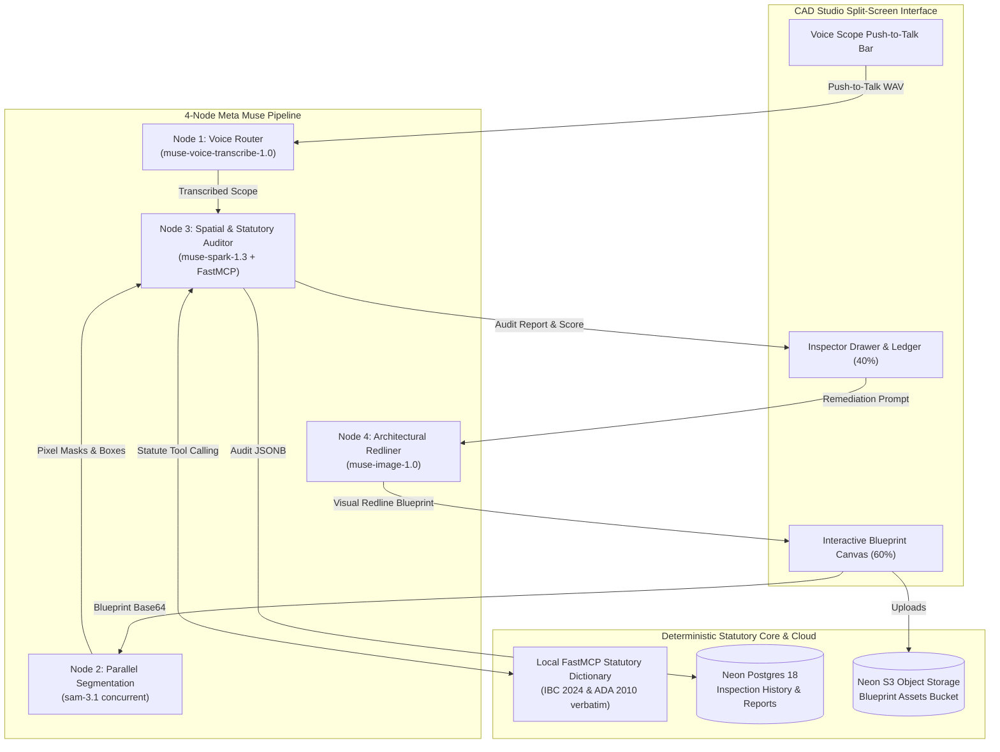

# PlanPass — AI Municipal Blueprint & Code Compliance Examiner

> **Built for the Meta Global AI Developer Hackathon (November 2026)**  
> Compressing a 16-week municipal plan review backlog into a 30-second interactive pre-check and generative visual remediation workflow.

---

## 🏗️ Architecture: 4-Node Closed-Loop Agent Pipeline

PlanPass combines four specialized Meta multimodal models into a closed-loop architectural pre-examination engine grounded in statutory building codes via Model Context Protocol (MCP):



---

## ⚡ Key Features (MoSCoW P0 & P1)

* **F1: Blueprint Ingestion & Sample Library (P0):** Drag-and-drop support for PNG, JPEG, WebP, and single-page PDFs, plus 3 pre-loaded sample floorplans. Samples are inputs only — every score, violation, overlay, and verdict is produced live by the 4-node pipeline from the actual image; nothing is precomputed.
* **F2: Voice-First Inspection Scope Bar (P0):** Push-to-talk audio recorder with real-time waveform visualization powered by `muse-voice-transcribe-1.0` and preset scope chips.
* **F3: Pixel-Accurate Element Segmentation (P0):** Concurrent `sam-3.1` segmentation for agent-proposed or caller-supplied concepts (no fixed list) rendered as interactive SVG overlays.
* **F4: Spatial Grounding & Statutory Audit (P0):** Cross-examination of floorplan dimensions against the runtime statute corpus in `data/statutes.json` (IBC 2024 / ADA 2010 / IRC, editable via `STATUTES_FILE`). Unverifiable citations are dropped with a warning — never silently trusted.
* **F5: Permit Readiness Score & Violation Ledger (P0):** Real-time 0–100% readiness gauge, pass/hold gate, and structured violation cards.
* **F6: Generative Architectural Redlining (P0):** One-click visual redline generation using `muse-image-1.0` that preserves existing wall geometry while overlaying crisp red architectural markups.
* **F7: Closed-Loop Re-Verification (P0):** Re-runs fixed plans through the examiner to verify that violations are resolved and unlock final PE sign-off.
* **F8: One-Click PE Sign-Off Permit Packet (P1):** Downloadable compliance report stamped with statutory checklist, agent trace, and sign-off certification.
* **F9: Sovereign Dataset Flywheel Export (P1):** One-click JSONL export of inspection records for air-gapped fine-tuning deployments.

---

## ☁️ Neon Cloud Infrastructure

* **PostgreSQL 18:** Serverless relational store for floorplans and JSONB inspection reports.
* **Object Storage:** S3-compatible private `assets` bucket for high-resolution blueprint raster files.
* **Neon Auth:** Reviewer sign-in and session management with JWKS verification.
* **Neon Realtime:** Live query sealing for real-time inspection feeds.
* **Neon Functions:** Deployed serverless compute microservices.

---

## 🚀 Quickstart (Under 60 Seconds)

### 1. Prerequisites
* Node.js v20+
* Credentials in `.env.local` (Neon connection strings + `MODEL_API_KEY` for `https://api.meta.ai/v1`)

### 2. Install & Build
```bash
npm install
npm run build
```

### 3. Start the Server
```bash
npm start
```
Open **[http://localhost:3000](http://localhost:3000)** in your browser.

### 4. Run the Full End-to-End Test Suite
```bash
node scripts/verify-e2e.mjs
```
Runs 18 automated integration tests verifying health, auth, benchmarks, S3 uploads, statutory MCP tools, and PDF/JSONL exports.
