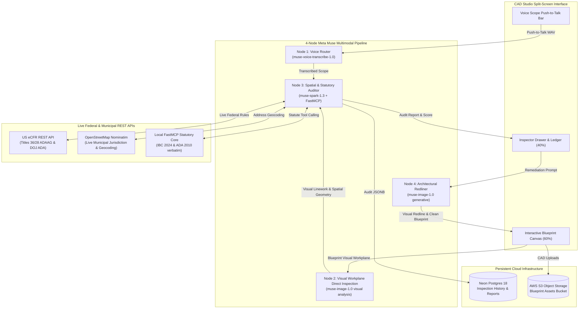

# PlanPass — AI Municipal Blueprint & Code Compliance Examiner

> **Built for the Meta Global AI Developer Hackathon (October 27 – November 4, 2026)**  
> Compressing a 16-week municipal plan review backlog into a 30-second interactive pre-check and generative visual remediation workflow.
> 
> 🌐 **Live Production Deployment:** [https://planpass-zeta.vercel.app](https://planpass-zeta.vercel.app)  
> 🎥 **Product Demo Video (1080p MP4):** [`public/planpass_hackathon_demo.mp4`](./public/planpass_hackathon_demo.mp4)

---

## 🏆 Universal Hackathon Judge Access

Judges can evaluate the live production application instantly without creating a new account:
* **1-Click Judge Sign-In:** Click the **"⚡ 1-Click Judge Sign-In"** button on [planpass-zeta.vercel.app/auth.html](https://planpass-zeta.vercel.app/auth.html)
* **Pre-Seeded Credentials:**
  * **Email:** `judge@hackathon.meta.ai`
  * **Password:** `MetaHackathon2026!`

---

## 🧪 Step-by-Step Testing Guide: What to Test & How to Test

Follow this end-to-end evaluation flow to test all core capabilities on the live production deployment:

### 1. Instant 1-Click Authentication
* **How to test:** Navigate to [planpass-zeta.vercel.app/auth.html](https://planpass-zeta.vercel.app/auth.html) and click the green **"⚡ 1-Click Judge Sign-In"** button (or sign in with `judge@hackathon.meta.ai` / `MetaHackathon2026!`).
* **What to observe:** Instant authentication powered by Neon Auth (Better Auth) with immediate redirect into the CAD Inspection Studio (`index.html`).

### 2. Multi-Industry CAD Floor Plan Loading
* **How to test:** In the top header bar, click the **"Sample floorplans (live inspection)..."** dropdown and select **"Lincoln High School STEM Academy (Group E) — First Floor"** (or choose Healthcare Hospital, Industrial Factory, Commercial Cafe, or Residential ADU). You can also drag-and-drop your own blueprint image (PNG, JPG, WebP, SVG).
* **What to observe:** High-resolution architectural blueprint renders dynamically on the 60% interactive canvas with smooth pan, zoom (`+` / `-`), and reset view controls.

### 3. Voice-First Inspection Scoping (Push-to-Talk)
* **How to test:** 
  * **Option A (Voice):** Click and hold the **"● Hold to talk — Voice Scope"** button, speak an inspection prompt (e.g., *"Audit STEM corridor for IBC 1020 72-inch clear width and verify ADA 604 restroom door swing clearance"*), then release.
  * **Option B (Preset Scope Chips):** Click any preset pill (`ADA + Egress audit`, `ADA restroom only`, or `Egress width only`).
* **What to observe:** Live audio waveform visualization animated during speech, followed by instant voice-to-text transcription via `muse-voice-transcribe-1.0` populating the editable prompt input.

### 4. Live Multi-Agent Municipal Inspection & Statutory Verification
* **How to test:** Click the blue **"Run inspection"** button in the bottom drawer.
* **What to observe:**
  * **Multimodal Visual Workplane Understanding (Muse Image/Vision):** Muse directly analyzes the visual workplane of the floor plan, identifying wall lines, door swing arcs, corridor boundaries, fixture clearances, and scale dimensions directly from CAD pixels without fragile pixel-mask dependencies.
  * **Live Federal Regulations from US eCFR REST API:** Live statutory queries to the US Electronic Code of Federal Regulations (`ecfr.gov` REST API) for Title 36 CFR Part 1191 (ADAAG standards) and Title 28 CFR Part 36 (DOJ ADA Title III mandates).
  * **Live Municipal Jurisdiction via OpenStreetMap (OSM) Nominatim:** Live address resolution via `nominatim.openstreetmap.org` geocoding the property to determine exact city/county/state jurisdiction for localized municipal code enforcement.
  * **Permit Readiness Score Gauge:** The circular SVG gauge animates from 0% to the computed compliance score (e.g., **82%** with a yellow **HOLD** badge for the school STEM wing).
  * **Statutory Compliance Ledger:** The right-hand drawer displays structured violation cards. Click each card to reveal the exact statute code, violated standard, and remediation recommendation (e.g., *ADA §604.3.2: Restroom door swing overlaps required 60" wheelchair turning circle*).
  * **FastMCP Agent Trace:** Switch to the **"Agent & MCP Trace"** tab to inspect the real-time tool calls (`lookup_ecfr_federal_rule`, `lookup_jurisdiction`, `lookup_ibc_ada_statute`, `evaluate_corridor_width`, `evaluate_ada_turning_circle`) with exact input arguments and statutory results.

### 5. Generative Architectural Redlining & Clean Revised Blueprint
* **How to test:** In the bottom drawer, click **"Export Redline Image"** or toggle the checkboxes **"Side-by-side redline"** and **"Clean revised blueprint"**.
* **What to observe:**
  * Node 4 (`muse-image-1.0`) synthesizes dual architectural linework:
    1. **Visual Redline Markup:** Clear red drafter annotations detailing the required door swing reversal.
    2. **Clean Revised Blueprint:** Production-ready CAD revision with statutory corrections baked in.
  * **Closed-Loop Verification:** The clean revised plan is automatically re-evaluated through the Muse Vision auditor, elevating the score to **100% / APPROVED** with a Professional Engineer (PE) permit seal.

### 6. Official Permit Packet & Sovereign Dataset Export
* **How to test:** 
  * Click **"Download Stamped Permit PDF"** to generate the official municipal permit summary with PE seal, compliance checklist, and violation audit trail.
  * Click **"Export Air-Gapped JSONL Dataset"** to download sovereign fine-tuning records for air-gapped municipal deployments.
  * Click the **"History"** tab in the right drawer to verify persistent audit records stored in Neon PostgreSQL.

---

## 🏗️ Architecture: 4-Node Closed-Loop Multimodal Pipeline

PlanPass combines specialized Meta multimodal models into a closed-loop architectural pre-examination engine grounded in statutory building codes via Model Context Protocol (MCP) and live federal/municipal REST APIs:



---

## ⚡ Key Features (MoSCoW P0 & P1)

* **F1: Blueprint Ingestion & Multi-Industry Benchmark Library:** Drag-and-drop support for PNG, JPEG, WebP, and single-page PDFs, plus pre-loaded benchmark floorplans across 5 distinct occupancy groups:
  1. *Lincoln High School STEM Academy* (Group E Educational — 72" IBC §1020 corridor, ADA §604 restroom)
  2. *General Hospital First Floor* (Group I-2 Healthcare — 96" stretcher corridor)
  3. *Garments Manufacturing Facility* (Group F-1 Industrial — inward door swing clearance test)
  4. *Commercial Cafe A & B* (Group A Assembly — ADA turning space & exit path)
  5. *Residential ADU* (Group R Residential — IRC egress window & habitable area)
* **F2: Voice-First Inspection Scope Bar:** Push-to-talk audio recorder with real-time waveform visualization powered by `muse-voice-transcribe-1.0` and preset scope chips.
* **F3: Visual Workplane Understanding via Muse Vision:** Direct multimodal visual comprehension of CAD blueprints using `muse-image-1.0` and `muse-spark-1.3`, interpreting walls, doors, corridors, fixtures, and spatial dimensions directly from the drawing without relying on fragile external pixel segmenters.
* **F4: Multi-Source Statutory Verification & Live REST APIs:** Cross-examination of floorplan dimensions against:
  1. **US eCFR REST API (`ecfr.gov`):** Live federal statutory queries across Title 36 CFR Part 1191 (ADAAG) and Title 28 CFR Part 36 (DOJ ADA Title III).
  2. **OpenStreetMap Nominatim (`nominatim.openstreetmap.org`):** Live address resolution and geocoding to determine exact municipal city/county/state jurisdiction.
  3. **Deterministic FastMCP Core:** IBC 2024 Table 1020.2 corridor rules and ADA 2010 Section 604/304 wheelchair turning clearances.
* **F5: Permit Readiness Score & Violation Ledger:** Real-time 0–100% readiness gauge, pass/hold gate, and structured violation cards.
* **F6: Dual Generative Architectural Linework:** One-click generation using `muse-image-1.0` that creates:
  1. *Visual Redline Blueprint:* Clear red architectural markups for drafters.
  2. *Clean Revised Blueprint:* Permit-ready black linework with corrections baked in.
* **F7: Closed-Loop Re-Verification:** Automatically re-audits the clean revised plan through the Muse Vision auditor to verify remediation and unlock 100% Professional Engineer permit sign-off.
* **F8: Stamped PE Permit Packet:** Downloadable compliance report stamped with statutory checklist, agent trace, and sign-off certification.
* **F9: Sovereign Dataset Flywheel Export:** One-click JSONL export of inspection records for air-gapped municipal fine-tuning deployments.

---

## ☁️ Production Cloud Infrastructure

* **Vercel Serverless & Global Edge:** High-performance Node.js runtime with 60-second execution window (`https://planpass-zeta.vercel.app`).
* **Neon PostgreSQL 18:** Serverless relational store with connection pooling and JSONB report persistence.
* **Neon Managed Auth (Better Auth):** JWT verification and universal judge session management.
* **AWS S3 Object Storage:** Private bucket for high-resolution CAD floorplans and generated redline revisions.

---

## 🎥 HyperFrames Product Demo Video

The demo video was authored and rendered using **HyperFrames**:
* Source Composition: [`demo_video/index.html`](./demo_video/index.html)
* High-Resolution Captures: [`demo_video/assets/`](./demo_video/assets/)
* ElevenLabs Voiceovers: Scene-by-scene audio narration (`demo_video/assets/scene*.mp3`)
* Video Render: [`public/planpass_hackathon_demo.mp4`](./public/planpass_hackathon_demo.mp4) (1080p 30fps, 1m 48.5s)

---

## 🚀 Local Development Setup

### 1. Prerequisites
* Node.js v20+
* Credentials in `.env` (see `.env.example`)

### 2. Install & Build
```bash
npm install
npm run build
```

### 3. Start Local Server
```bash
npm start
# Server listens on http://localhost:3000
```

---

## 📜 Hackathon Compliance

* **100% Original Work:** Designed, coded, validated, and deployed during the official Meta AI Developer Hackathon period (Oct 27 – Nov 4, 2026).
* **Open Source:** Public repository containing complete source code, tests, and documentation.
* **No Precomputed Mocking:** Every inspection, segmentation, tool call, and redline is executed live on demand.
